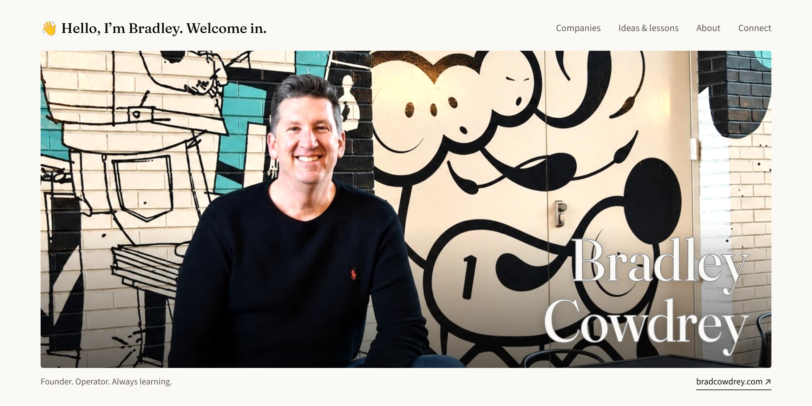

<a href="https://bradcowdrey.com">
  <picture>
    <source media="(prefers-color-scheme: dark)" srcset="assets/banner-dark.jpg">
    
  </picture>
</a>

  
  
  
  
  

### 👋 Great to have you here.

I’m the co-founder and CEO of [**Eveoy**](https://eveoy.com). The idea is simple: click a button and get customers in-store to experience your brand, sample, buy, try, and take photos in-store.

Along the way, thousands of AI questions have landed in my DMs and inbox. I love helping, and I have Eveoy to run. So I’m putting that advice into practical posts and my book, helping more of you get more from the AI tools you already use.

---

WHAT I’M WORKING ON

### Building Eveoy. Sharing what helps.

- 🛍️ **[Eveoy](https://eveoy.com)** · Real customers for your brand, on demand. In-store and online. Pay for results.
- 📘 **AI Skills Bible** · My book. The concepts, skills, and routines to keep close as you put AI to work. *Coming soon on Amazon and Gumroad.*
- 🧰 **[Kyee AI](https://kyee.ai)** · Practical AI skills from me, with turnkey help from our partner. *Live now.*
- ✍️ **[Ideas & lessons](https://bradcowdrey.com/#notes)** · Plain explanations for people with a business to run.

WHAT YOU’LL FIND HERE

The practical side: AI skills, prompts, and small tools I use myself and share as they’re ready. An **AI skill** is a reusable set of instructions that helps AI do a specific job. Learn it once, adapt it to your business, and use it again.

THE QUESTIONS I HEAR MOST

| “What if AI gets it wrong?” | “Why doesn’t it sound like us?” | “Why does it forget my business?” |
| --- | --- | --- |
| Give drafting and checking their own steps. A Doer drafts. A Checker reviews. | Set the standard, rate the draft against it, refine what matters. | Write a reusable brief about your business, brand, and audience. |

[More lessons on bradcowdrey.com ↗](https://bradcowdrey.com/#notes)

---

THE COMPANY SIDE

### Business is where the lessons begin.

I’ve built and sold companies, and I advise, invest in, and operate businesses. **Build · Advise · Invest · Operate.**

| Company | My role | Focus |
| --- | --- | --- |
| [**Eveoy**](https://eveoy.com) | Co-Founder and CEO | Changing the future of marketing and advertising |
| [**Clear Peak**](https://clearpeak.com) | Founder and CEO · 2000–2018 | Advanced intelligence for enterprise and governments |
| [**Silverlane**](https://silverlane.io) | Founding Board Member | Enterprise technology |
| [**Kyee AI**](https://kyee.ai) | Advisor | Making AI work for every business leader |
| [**Karibu AI**](https://www.karibu.ai/) | Board of Advisors | Healthcare AI |
| [**Omnity AI**](https://www.omnity.io) | GTM Founding Member and Advisor | Advanced semantic AI |
| [**Fellow Man**](https://fellowman.us/) | Founding Board Member and Advisor | Luxury fashion (technology) for men |

Plus three in quiet mode

| Company | My role | Focus |
| --- | --- | --- |
| **AGI Startup** | Founding Board Member and Advisor | Artificial general intelligence |
| **Crypto Startup** | Founding Board Member and Advisor | Next generation of cryptocurrency |
| **Quantum Labs** | Research Collaborator | Quantum computing |

WHAT I BUILD WITH

---

### We’re all learning what comes next.

Get useful AI lessons, stories from building companies, and updates on the skills and book as they launch at **[bradcowdrey.com](https://bradcowdrey.com/#connect)**.

*Let’s put it to use for you.* 
**Bradley**

[bradcowdrey.com](https://bradcowdrey.com) · [LinkedIn](https://www.linkedin.com/in/cowdrey/) · [X](https://x.com/bradcowdrey) · [Instagram](https://www.instagram.com/bradleycowdrey/)
