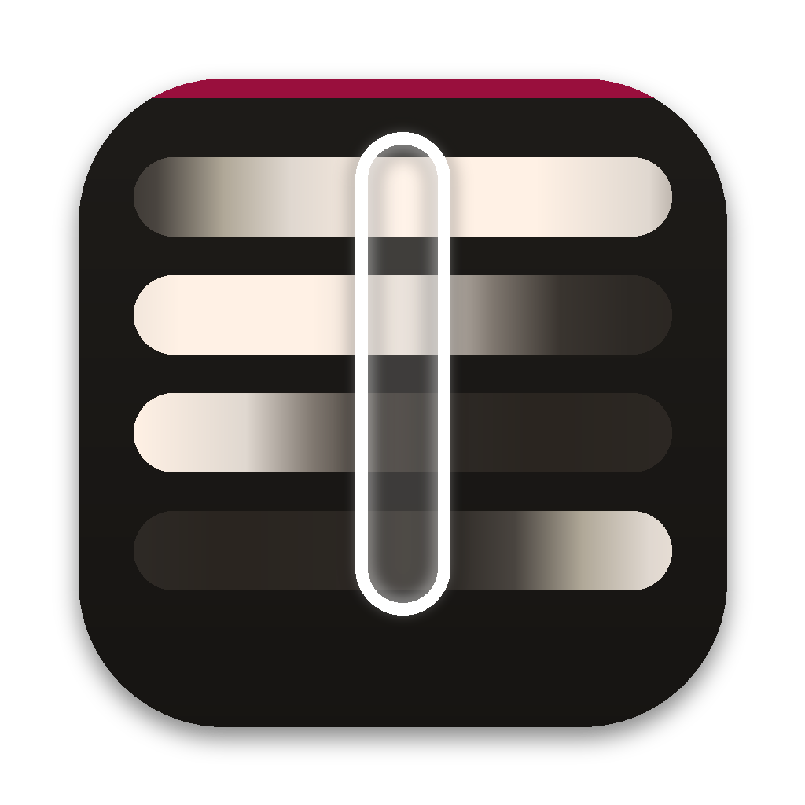

<p align="center"></p>

<h1 align="center">Meridian</h1>
<p align="center"><b>Every time zone at a glance.</b><br>
A tiny, free, open-source world clock for your Mac's menu bar.<br>
Made by <a href="https://bradcowdrey.com">Bradley Cowdrey · bradcowdrey.com</a></p>

<p align="center">
  <a href="https://github.com/bc101101/bc101101/releases/tag/meridian-v0.1.0"><b>Download for Mac</b></a> ·
  <a href="https://bradcowdrey.com/meridian">Website & live demo</a> ·
  <a href="https://github.com/bc101101/bc101101/issues">Report an issue</a>
</p>

---

Meridian lines up your cities as day-and-night ribbons on one grid. Every column is the same
instant everywhere, so the line through the middle is *now*.

## Features

- **Day/night ribbons**: night navy, dawn peach, daylight sand and dusk orange, one row per city.
- **Time travel**: drag the strip, scroll, press ← →, or click any hour. **Now** snaps back.
- **Meeting overlap**: a green dot marks hours when every city is inside working hours.
- **Copy the moment**: one click copies the selected time for every city, ready to paste into a chat or invite.
- **Fast search**: city names, airport codes (`SFO`, `LHR`), abbreviations (`PST`, `CET`) or offsets (`UTC+5:30`).
- **The details**: day-change markers, half-hour and 45-minute zones, a `+1 day` badge, 12/24-hour time, custom city names, drag to reorder.
- **Menu bar first**: show an icon, or a city and its time (`LON 14:32`). Open it as a desktop window that can float above everything.
- Open at login. No account, no tracking, no network access. About 1 MB.

Native SwiftUI, universal binary (Apple silicon + Intel), macOS 14 Sonoma or later.

## Install (sideload)

Meridian is distributed directly, not through the Mac App Store.

1. Download `Meridian-x.y.z.dmg` from [Releases](https://github.com/bc101101/bc101101/releases/tag/meridian-v0.1.0)
   or [bradcowdrey.com/meridian](https://bradcowdrey.com/meridian).
2. Open the DMG and drag **Meridian** to **Applications**.
3. First launch: if macOS says it can't verify the app, **right-click Meridian → Open → Open**, or run
   `xattr -dr com.apple.quarantine /Applications/Meridian.app`
4. Look for the globe in your menu bar.

## Build from source

Requires Xcode 15.3+ (Swift 5.10) on macOS 14+.

```sh
git clone https://github.com/bc101101/bc101101.git -b meridian
cd bc101101
swift run                         # run in development
scripts/build-app.sh 0.1.0        # dist/Meridian.app (universal)
scripts/make-dmg.sh 0.1.0         # dist/Meridian-0.1.0.dmg
```

## Releasing

Push a tag and GitHub Actions builds a universal app, packages a DMG and publishes it on Releases:

```sh
git tag v0.1.0 && git push origin v0.1.0
```

Optional secrets for Developer ID signing and notarization (removes the Gatekeeper prompt):
`DEVELOPER_ID_P12` (base64 .p12), `DEVELOPER_ID_P12_PASSWORD`, `CODESIGN_IDENTITY`,
`NOTARY_APPLE_ID`, `NOTARY_PASSWORD` (app-specific password), `NOTARY_TEAM_ID`.
Without them, builds are ad-hoc signed.

## Layout

```
Sources/Meridian/
  MeridianApp.swift       Menu bar, desktop window, settings
  Brand.swift             Name, author and links: rebrand here
  Model/                  Cities, search directory, settings and time maths
  Views/StripView.swift   The ribbons
  Views/ClockPanel.swift  Header, time-travel bar, add-city search
docs/                     Download page with a live web demo
```

## License

MIT © 2026 Bradley Cowdrey · [bradcowdrey.com](https://bradcowdrey.com)
