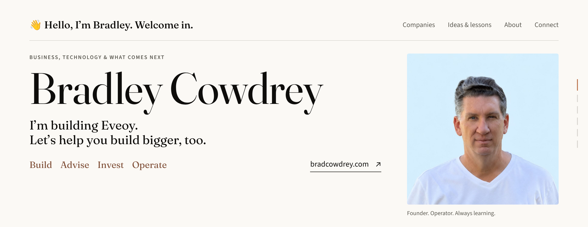

<a href="https://bradcowdrey.com">
  <picture>
    <source media="(prefers-color-scheme: dark)" srcset="assets/banner-dark.png">
    
  </picture>
</a>

  
  
  
  

BUSINESS, TECHNOLOGY &amp; WHAT COMES NEXT

### I’m building Eveoy. Let’s help you build bigger, too.

**Great to have you here.** I’m the co-founder and CEO of [Eveoy](https://eveoy.com). The idea is simple: click a button and get customers in-store to experience your brand, sample, buy, try, and take photos in-store.

Along the way, thousands of AI questions have landed in my DMs and inbox. I love helping, and I have Eveoy to run. So I’m putting that advice into practical posts and my book, helping more of you get more from the AI tools you already use.

**[Visit bradcowdrey.com ↗](https://bradcowdrey.com)**

---

COMING NEXT

### Keep going. I’ll help you get there.

- **AI Skills Bible** · *Coming soon on Amazon and Gumroad.* The concepts, skills, and routines to keep close as you learn and put AI to work.
- **[Kyee AI](https://kyee.ai)** · *Live at kyee.ai.* Practical AI skills from me and turnkey help from our partner, from your first useful prompt to more capable everyday work.

---

THE COMPANY SIDE

### Business is where the lessons begin.

I’ve built and sold companies, and I advise, invest in, and operate businesses.

**Build · Advise · Invest · Operate**

| Company | My role | Focus |
| --- | --- | --- |
| [**Eveoy**](https://eveoy.com) | Co-Founder and CEO | Bring real customers to your brand on-demand. In-store and online. |
| [**Silverlane**](https://silverlane.io) | Founding Board Member · 2017–Present | Enterprise technology |
| [**Kyee AI**](https://kyee.ai) | Advisor | Making AI work for every business leader |
| [**Karibu AI**](https://www.karibu.ai/) | Board of Advisors | Healthcare artificial intelligence |
| [**Clear Peak**](https://clearpeak.com) | Founder and CEO · 2000–2018 | Advanced intelligence for enterprise and governments |
| [**Omnity AI**](https://www.omnity.io) | GTM Founding Member and Advisor | Building advanced semantic AI |
| [**Fellow Man**](https://fellowman.us/) | Founding Board Member and Advisor | Luxury fashion (technology) for men |
| **AGI Startup** | Founding Board Member and Advisor · 2019–Present | Artificial general intelligence |
| **Crypto Startup** | Founding Board Member and Advisor · 2017–Present | Next generation of cryptocurrency |
| **Quantum Labs** | Research Collaborator · 2018–Present | Quantum computing |

[All companies on bradcowdrey.com ↗](https://bradcowdrey.com/#companies) · [My experience on LinkedIn ↗](https://www.linkedin.com/in/cowdrey/details/experience/)

---

WHAT I BUILD WITH

---

A LITTLE ABOUT BRADLEY

### I’m learning by doing. And sharing what helps.

In conversations with business owners, I keep hearing the same concerns about AI: it makes mistakes, it forgets the context, and getting a useful result takes too much effort.

That’s where my teaching starts. Clear explanations. Small, repeatable skills. A way to check the work before you put your name on it.

*Let’s put it to use for you.* 
**Bradley**

[bradcowdrey.com](https://bradcowdrey.com) · [LinkedIn](https://www.linkedin.com/in/cowdrey/) · [X](https://x.com/bradcowdrey) · [Instagram](https://www.instagram.com/bradleycowdrey/)
